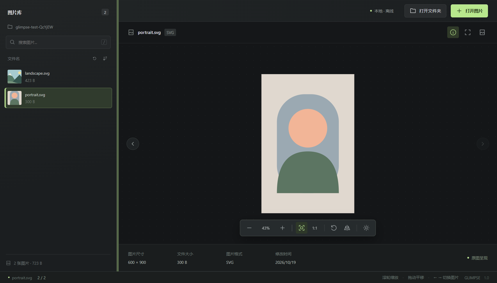

# Glimpse

Windows 本地图片预览应用，使用 Electron、TypeScript 和 Less。图片仅在本机读取，不上传网络。

## 界面预览



支持拖动调宽的侧边栏、至少 11px 的界面字体及柔和过渡动画，尊重系统的减少动态效果设置。

## 功能

- 打开图片、文件夹或拖入图片，浏览同目录缩略图，支持文件名搜索及正反排序。
- 全屏按钮旁新增图片全屏按钮：仅显示图片，按 Esc 退出，恢复普通浏览界面。
- 上下方向键按当前列表的搜索结果与排序切换图片；在搜索框输入时不触发切图。
- 自动监听当前文件夹：从 Windows 回收站还原图片、添加或移除图片后，列表自动更新。保留搜索、排序及仍存在的当前图片，其缩放、旋转状态也会保留。
- 排序旁保留手动刷新按钮；窗口重新获得焦点时也会检查当前目录。
- 悬停或聚焦图片行可将图片移至 Windows 回收站。删除当前图片后选择相邻图片，删除最后一张后回到空白状态。
- 滚轮缩放、拖动平移、适应窗口、原始尺寸、旋转、水平翻转、背景切换、窗口全屏及图片信息。
- 自定义退出弹窗支持最小化到托盘、直接退出和取消；点击托盘图标恢复窗口，托盘菜单可退出应用。
- 支持 PNG、JPEG、WebP、GIF、BMP、SVG、AVIF、ICO，解码能力取决于 Chromium；暂不支持 RAW、HEIC、TIFF。

目录自动更新依赖操作系统文件通知；网络磁盘或特殊文件系统可能延迟，此时可点击刷新。应用不直接操作回收站恢复，请在 Windows 回收站中还原图片。

## 开发

使用 Node.js 22.13 或更高的 22.x 版本，或 Node.js 24 及以上版本。

```powershell
npm install
npm start
```

`npm start` 和 `npm run dev` 会先编译 TypeScript 与 Less，再启动 Electron。修改源码后重新启动即可加载最新代码。

源码样式只维护 `src/style.less`，不维护 CSS 源文件。构建时生成 `dist/src/style.css`，供 Electron 加载；`dist/` 为忽略提交的生成目录。

## 统一代码规范

统一使用四个空格缩进、UTF-8、LF 换行。Prettier 负责格式，ESLint 检查 TypeScript 和脚本，Stylelint 检查 Less。

项目已配置 `.editorconfig` 和 VS Code 工作区设置。使用 VS Code 的维护者安装工作区推荐扩展后，保存文件会自动格式化并执行 ESLint、Stylelint 自动修复。其他编辑器可使用 EditorConfig 与对应的 Prettier 集成。

```powershell
npm run format       # 格式化项目
npm run format:check # 检查格式
npm run lint         # ESLint 与 Stylelint 检查
npm run lint:fix     # 自动修复可修复的规范问题
npm run typecheck    # TypeScript 严格类型检查
npm run check        # 类型、规范、格式及构建检查
npm test             # 构建并执行真实 Electron 回归测试
```

测试覆盖图片加载、搜索排序、上下键导航、图片全屏与 Esc、目录自动更新、手动刷新、视图状态保留、回收站删除、缩放旋转、侧边栏调整和托盘退出流程。测试只删除临时目录中的测试图片。

## 项目结构

```text
electron/
    main.cts        Electron 主进程及文件夹监听
    preload.cts     隔离的渲染进程接口
src/
    app.ts          图片浏览与交互
    viewer.d.ts     图片数据与跨进程接口类型
    style.less      Less 样式源文件
    index.html      应用界面
    assets/         应用图标
scripts/
    build.ts        TypeScript、Less 及静态资源构建
tests/
    smoke.cjs       Electron 回归测试
dist/               自动生成的运行文件，不提交
```

主进程和 preload 使用 `.cts`，构建为 Electron 所需的 `.cjs`；页面脚本由 esbuild 编译。所有应用源码开启 TypeScript 严格检查，构建不依赖开发服务器。

## 快捷键

| 操作                        | 按键                  |
| --------------------------- | --------------------- |
| 打开图片 / 文件夹           | Ctrl+O / Ctrl+Shift+O |
| 按列表顺序切图              | ↑ / ↓                 |
| 上一张 / 下一张             | ← / →                 |
| 缩放                        | + / - 或滚轮          |
| 适应窗口 / 原始尺寸         | 0 / 1                 |
| 旋转 / 水平翻转             | R / H                 |
| 窗口全屏                    | F                     |
| 退出图片全屏 / 取消退出弹窗 | Esc                   |
| 聚焦搜索框                  | /                     |

聚焦侧边栏分隔条时，可用左右方向键调整侧边栏宽度。

## Windows 打包

```powershell
npm run dist
```

先构建，再输出 NSIS 安装包与便携版到 `release/`。安装版支持常见图片文件关联。打包只包含 `dist/` 运行文件与应用元数据，不包含 TypeScript、Less 源文件或测试。

Electron 自带 Chromium，安装体积通常数十到上百 MB。应用采用无框架、无服务端结构，启用 preload 隔离、禁用 Node 集成和渲染进程沙箱，并通过受限的本地图片协议访问已打开的图片。
